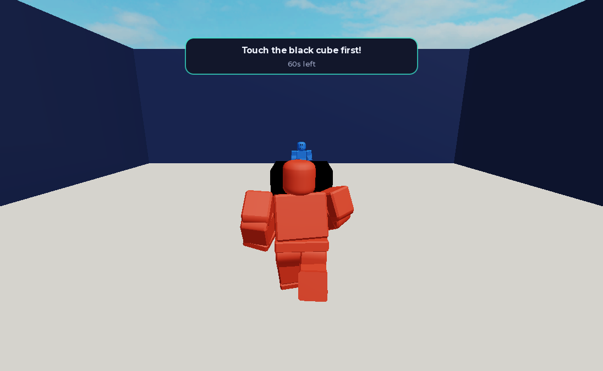
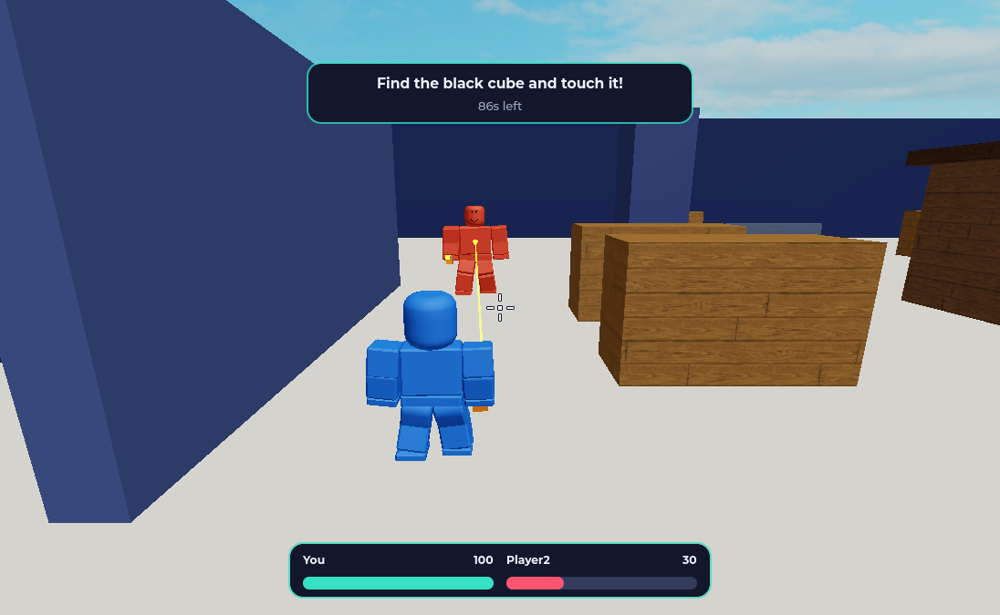
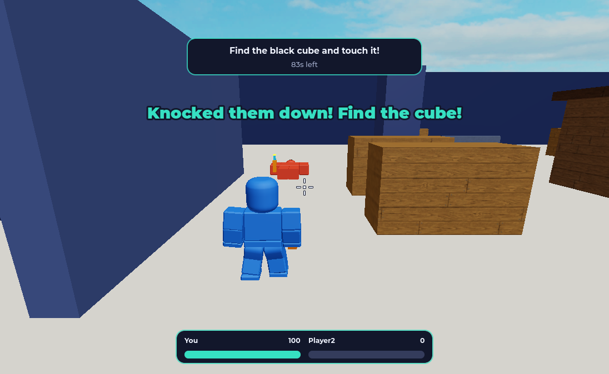

# Morph Duels

A Roblox game. Walk up to a player in the hub, invite them to a duel, and race them to find a black
cube hidden in your own room, each in a different form. The winner gets a point on the scoreboard.

Morph Duels is a working title. The idea is inspired by the show Chaotic, but the game needs its own
name, creatures and art before it goes public on Roblox.



## What works now

- A flat hub where you can walk up to any player and click them.
- An invite window at the top of the screen, and an Accept or Decline popup for the other player.
- 8 duel rooms that are reserved and released automatically.
- Teleporting into a room and turning into a different form.
- A 128 by 128 room with cover, where the black cube hides at a different spot each duel.
- 90 seconds to find it first, with Wins on the scoreboard.
- A toy blaster with health bars. A body shot takes 15% of health and a headshot 35%. At zero
  you're knocked down for 5 seconds, then get up with 2 seconds of protection while health
  refills. Knocking someone down buys you time to search. Only the cube wins.
- Dying, leaving or running out of time ends the duel with no point.

Powers, DNA, other worlds and monster models are not in yet. Those come next, see
[PLAN.md](PLAN.md).

## Controls in a duel

| Action | Computer | Phone |
|---|---|---|
| Move | WASD | thumbstick |
| Aim | move the mouse, the camera sits over your right shoulder | drag the screen |
| Fire | click, or hold to keep firing | hold the FIRE button |




## First-time setup

You need Windows or macOS, plus [Git](https://git-scm.com/downloads).

**1. Install [Roblox Studio](https://create.roblox.com/docs/studio/setup)**, open it once and sign
in.

**2. Install [Rokit](https://github.com/rojo-rbx/rokit).** It installs the exact tool versions this
project uses, so everyone stays in sync.

On Windows, in PowerShell:

```powershell
Invoke-RestMethod https://raw.githubusercontent.com/rojo-rbx/rokit/main/scripts/install.ps1 | Invoke-Expression
```

On macOS:

```bash
curl -sSf https://raw.githubusercontent.com/rojo-rbx/rokit/main/scripts/install.sh | bash
```

Close the terminal and open a new one, so it can find `rokit`.

**3. Get the code and its tools:**

```bash
git clone https://github.com/nivsasi1/cahotic-blox.git
cd cahotic-blox
rokit install
```

If it asks whether to trust a tool, say yes. These are the tools in `rokit.toml`.

Run `rojo`, `lune` and the other tools from inside this folder. Rokit can't find them anywhere else.

**4. Install the Rojo plugin for Studio**, with Studio closed:

```bash
rojo plugin install
```

**5. Optional, for VS Code:**

```bash
code --install-extension JohnnyMorganz.luau-lsp
code --install-extension evaera.vscode-rojo
```

## Run the game

1. Build the place:

   ```bash
   rojo build -o morph-duels.rbxlx
   ```

2. Open `morph-duels.rbxlx` in Roblox Studio.
3. In the **Test** tab choose **Clients and Servers**, set **2 Players**, press **Start**. Two
   windows open, one per player.
4. In one window, walk to the other player and click them, then press **Invite**.
5. In the other window, press **Accept**.

The built place is ignored by Git. Build it again after pulling new code.

## Change the game

Live sync shows saved files in Studio right away:

```bash
rojo serve
```

Then in Studio open the **Plugins** tab, click **Rojo**, then **Connect**.

Files are the source of truth. A script edited in Studio is lost on the next build, so edit scripts
in your code editor.

## Find your way around

[ROADMAP.md](ROADMAP.md) has the full map: how a duel flows, what every file does, every setting and
every remote. The short version:

| Folder | What's in it |
|---|---|
| `src/shared` | `Config.luau` with all the settings, and helpers used by both sides |
| `src/server` | Game rules, by feature: `Combat`, `Duels`, `Forms`, `Invites`, `Score` |
| `src/client` | What players see, by feature: `Combat`, `Duels`, `Hub`, `Invites`, plus `Common` UI parts |
| `assets/arenas` | The duel room |
| `assets/forms` | Monster models, see the [guide](assets/forms/README.md) |
| `tests` | Unit tests and the two-player test |
| `default.project.json` | What goes where in Studio, the remotes and the hub map |

For most tweaks, start in `src/shared/Config.luau`.

## Test it

Room and invite logic, in the terminal, no Studio needed:

```bash
lune run tests/unit
```

Lint:

```bash
selene src tests
```

Type check. Download the Roblox types once, and on Windows PowerShell write `curl.exe`:

```bash
curl -L --create-dirs -o .cache/globalTypes.d.luau https://raw.githubusercontent.com/JohnnyMorganz/luau-lsp/main/scripts/globalTypes.d.luau
```

Then run:

```bash
rojo sourcemap default.project.json -o sourcemap.json
luau-lsp analyze --sourcemap sourcemap.json --definitions .cache/globalTypes.d.luau --ignore "tests/**" src
```

The full game, Windows only:

```powershell
.\tests\integration\run.ps1
```

This opens Studio with one server and two clients and plays a scripted match through invites,
decline, cooldown, a cube win, a blaster fight with a knockdown, dying, time running out and
leaving. It prints every check, saves
screenshots to `.cache\shots`, and closes the Studio windows it opened. Studio must be signed in.

The test calls the click logic directly, so try a real mouse click yourself after changing
`PlayerPicker`.

## Working together

`main` always works, so nobody commits to it directly. Start each change on its own branch:

```bash
git switch main
git pull
git switch -c short-feature-name
```

When it's ready, run the tests, push the branch and open a pull request into `main`:

```bash
git push -u origin short-feature-name
```

Keep pull requests small. Commit messages are one short sentence in plain English.
