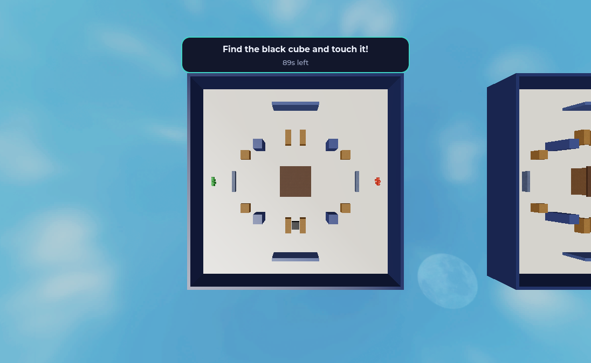

# Code roadmap

What lives where, how the pieces talk, and what to change for what.

Setup is in the [README](README.md). Milestones and decisions are in [PLAN.md](PLAN.md).

## How a duel flows

1. **Pick a player.** `PlayerPicker` raycasts from the mouse every frame, highlights the player
   under it, and opens `InviteWindow` on click.
2. **Send the invite.** `InviteWindow` fires `InviteSend`. `InviteService` checks the target is
   real, free and in range, then `InviteBook` records the invite.
3. **Answer it.** `InviteService` tells both players through `InviteState`. `InvitePopup` shows
   Accept and Decline, and the answer comes back through `InviteAnswer`.
4. **Reserve a room.** On accept, `InviteService` calls `DuelService.start`, which takes a room
   from `RoomPool`.
5. **Teleport and transform.** `DuelService` fades the screen, `Arenas` hides the cube on one of
   the room's spots, `FormService` swaps each character for a form, and `Arenas` says where each
   player stands, facing the middle of the room. `HealthService` fills both health bars and
   `BlasterService` hands out the toy blasters. Players are frozen for the countdown.
6. **Search and fight.** `DuelService` unfreezes everyone and listens for a touch on the cube. It
   sends every step through `DuelState` to `DuelHud`, `CombatHud`, `Blaster` and `ShoulderCamera`.
   A click fires `BlasterFire` with the point under the crosshair. `BlasterService` checks the
   shot, raycasts it from the blaster's muzzle, and tells `HealthService` about a hit. Both
   players get a `BlasterShot` to draw.
7. **Knockdowns.** At zero health `HealthService` anchors the player on their back for 5 seconds,
   then stands them up with 2 seconds of protection while health refills. A knocked down player
   can't shoot or take the cube. Shooting never wins a duel, it only buys time to search.
8. **Win and go home.** The first touch calls `ScoreService.award`. Health and blasters are
   cleared, everyone reloads into their own avatar on the hub spawn, and the room goes back to
   `RoomPool`.

A duel can also end by someone dying, leaving, or time running out. None of those give a point.

## Folders

```
assets/
  arenas/ArenaTemplate.model.json   the duel room, cloned once per room
  forms/                            monster models, one .rbxm per form
docs/screenshots/                   pictures for the README
src/
  shared/                           used by server and client
    Config.luau                     every number you might want to tweak
    Characters.luau                 player to body, body part to player, freezing a body
  server/
    init.server.luau                starts everything in order
    Combat/
      BlasterService.luau           hands out blasters and checks every shot
      HealthService.luau            health per duelist, knockdowns, getting up
      Vitals.luau                   health, knockdown and refill rules (pure logic)
      Cooldown.luau                 how often a player may fire (pure logic)
    Duels/
      DuelService.luau              runs a duel from start to finish
      Arenas.luau                   builds the rooms, hides the cube, finds the spawn points
      RoomPool.luau                 which rooms are reserved (pure logic)
    Forms/
      FormService.luau              picks forms and swaps the character
    Invites/
      InviteService.luau            receives requests from clients and checks them
      InviteBook.luau               who invited whom, timeouts, cooldowns (pure logic)
    Score/
      ScoreService.luau             the Wins scoreboard
  client/
    init.client.luau                connects everything, no logic of its own
    Combat/
      Blaster.luau                  firing, tracers, muzzle flash, the phone FIRE button
      CombatHud.luau                crosshair, hit markers, health bars, knocked down screen
      ShoulderCamera.luau           over-the-shoulder camera and mouse lock while live
      Sfx.luau                      plays the sounds from Config.SOUNDS
    Common/
      Ui.luau                       colors and UI building blocks
      Toast.luau                    short messages, like "Get closer first"
    Duels/
      DuelHud.luau                  fade, countdown, goal panel, result
      DuelCamera.luau               camera during a duel
    Hub/
      HubHint.luau                  the hint line at the bottom of the screen
    Invites/
      PlayerPicker.luau             hover and click on a player
      InviteWindow.luau             the window at the top for the inviter
      InvitePopup.luau              the Accept and Decline popup
tests/
  unit.luau                         invite, room, health and cooldown logic, runs in the terminal
  integration/                      plays the real game in Studio with two clients
```

## Where things end up in Studio

Rojo builds the place from these files. `default.project.json` is the map between the two:

| On disk | In Studio |
|---|---|
| `src/shared` | `ReplicatedStorage.Shared` |
| `src/server` | `ServerScriptService.Server` |
| `src/client` | `StarterPlayer.StarterPlayerScripts.Client` |
| `assets/arenas/ArenaTemplate.model.json` | `ServerStorage.ArenaTemplate` |
| `assets/forms` | `ServerStorage.Forms` |
| Written directly in `default.project.json` | `ReplicatedStorage.Remotes`, `Workspace.Baseplate`, `Workspace.HubSpawn` |

## What to change for what

| I want to | Go to |
|---|---|
| Change invite range, timers, room count | `src/shared/Config.luau` |
| Change a placeholder form | `PLACEHOLDER_FORMS` in `Config.luau` |
| Add a real monster | `assets/forms`, see [Adding a monster](#adding-a-monster) |
| Change the hub map | `default.project.json`, under `Workspace` |
| Change the duel room | `assets/arenas/ArenaTemplate.model.json` |
| Add or move a cube hiding spot | the `CubeSpots` folder in `ArenaTemplate.model.json` |
| Change damage, fire rate, knockdown or refill time | the combat settings in `Config.luau` |
| Change what a shot checks or hits | `onFire` in `src/server/Combat/BlasterService.luau` |
| Change how the blaster looks | `build` in `BlasterService.luau` |
| Change knockdown and getting up | `layDown` and `standUp` in `src/server/Combat/HealthService.luau` |
| Change a sound | `SOUNDS` in `Config.luau` |
| Change the aiming camera | `OFFSET` and `ZOOM` in `src/client/Combat/ShoulderCamera.luau` |
| Change how you win | `goLive` in `src/server/Duels/DuelService.luau` |
| Change what ends a duel | the calls to `finish` in `DuelService.luau` |
| Change who can invite whom | `onSend` in `InviteService.luau` and `send` in `InviteBook.luau` |
| Change how players transform | `FormService.apply` in `src/server/Forms/FormService.luau` |
| Add a scoreboard stat | `setUp` in `src/server/Score/ScoreService.luau` |
| Change UI colors | `Ui.colors` in `src/client/Common/Ui.luau` |
| Change text during a duel | `phases` and `resultText` in `src/client/Duels/DuelHud.luau` |
| Change invite error messages | `MESSAGES` in `src/client/Common/Toast.luau` |
| Add a remote event | `default.project.json`, under `Remotes`, then rebuild |

The room is 128 by 128 studs with cover in the middle: a hut, two alcoves, pillars, crates and low
walls. It needs parts named exactly `Cube`, `SpawnA` and `SpawnB`, because `Arenas.luau` finds them
by name. Each part in the `CubeSpots` folder is a place the cube can hide. Keep them invisible with
CanCollide, CanTouch and CanQuery off, and mirror them so neither spawn is closer on average. The
cube never lands on the same spot twice in a row.



## Settings

All in `src/shared/Config.luau`:

| Setting | Default | What it does |
|---|---|---|
| `INVITE_RANGE` | 30 | Studs. How close you must be to click someone |
| `INVITE_RANGE_SLACK` | 10 | Extra studs the server allows, since players keep moving after the click |
| `INVITE_TIMEOUT` | 15 | Seconds to answer an invite |
| `INVITE_COOLDOWN` | 5 | Seconds before you can re-invite someone who said no |
| `ROOM_COUNT` | 8 | Duel rooms, so also the most duels at once |
| `ROOM_ORIGIN` | 3000, 100, 0 | Where the rooms start, far enough that the hub can't see them |
| `ROOM_SPACING` | 200 | Studs between rooms |
| `FADE_TIME` | 0.4 | Seconds for the screen fade |
| `COUNTDOWN` | 3 | Seconds before the search starts |
| `DUEL_TIMEOUT` | 90 | Seconds before a duel ends with no winner |
| `RESULT_TIME` | 3 | Seconds the result stays on screen |
| `DUEL_HEALTH` | 100 | Health at the start of a duel |
| `BLASTER_BODY_DAMAGE` | 0.15 | Share of max health a body shot takes |
| `BLASTER_HEAD_DAMAGE` | 0.35 | Share of max health a shot on a part named `Head` takes |
| `BLASTER_COOLDOWN` | 0.25 | Seconds between shots, so 4 a second |
| `BLASTER_COOLDOWN_SLACK` | 0.05 | The server allows shots this much faster, since network timing jitters |
| `BLASTER_RANGE` | 250 | Studs a shot travels |
| `KNOCKDOWN_TIME` | 5 | Seconds on the floor at zero health |
| `REGEN_TIME` | 6 | Seconds to refill from empty to full after getting up |
| `GETUP_PROTECTION` | 2 | Seconds after getting up where shots do nothing |
| `SOUNDS` | sounds that ship with Roblox | Blaster, hit marker, knockdown and get up sounds |
| `PLACEHOLDER_FORMS` | Ember, Tide, Moss | Stand-ins used while `assets/forms` has no models |

Damage is a share of max health, so changing `DUEL_HEALTH` keeps the balance: 7 body shots or 3
headshots knock someone down.

## Project files

| File | What it sets |
|---|---|
| `default.project.json` | What goes where in Studio, the remotes, the hub map, world settings |
| `rokit.toml` | Exact versions of Rojo, Lune, luau-lsp and Selene |
| `selene.toml` | Lint rules |
| `.gitignore` | Keeps built places and tool caches out of Git |

## Remotes

The client only ever asks. The server checks every request and then tells the clients what
happened.

| Remote | Direction | Sends |
|---|---|---|
| `InviteSend` | client to server | the target player |
| `InviteCancel` | client to server | nothing |
| `InviteAnswer` | client to server | `true` or `false` |
| `InviteState` | server to client | `{ kind, ... }`, see below |
| `DuelState` | server to client | `{ phase, ... }`, see below |
| `BlasterFire` | client to server | the world point under the crosshair |
| `BlasterShot` | server to client | `{ shooter, from, to, part, result }`, sent to both duelists |

`BlasterShot` has `part` (`head` or `body`) and `result` (`hit`, `down` or `ignored`) only when the
shot reached the opponent. The shooter draws their own tracer the moment they click and uses this
for the hit marker. The opponent uses it to draw the shot.

Health lives in Player attributes, set only by the server while a duel runs: `HP`, `MaxHP`,
`Downed` and `Protected`. Any client can read them, which is how `CombatHud` draws both bars.

`InviteState` kinds:

| Kind | Extra fields |
|---|---|
| `sent` | `target` |
| `received` | `from` |
| `rejected` | `reason`: `pending`, `busy`, `cooldown`, `too_far`, `no_rooms`, `self` |
| `closed` | `reason`: `accepted`, `declined`, `cancelled`, `timeout`, `left` |

`DuelState` phases, in order:

| Phase | Extra fields |
|---|---|
| `starting` | none |
| `countdown` | `seconds`, `opponent`, `form` |
| `live` | `seconds` |
| `result` | `winner`, `reason`: `cube`, `cancelled`, `timeout`, `left` |
| `returning` | none |
| `ended` | none |

A new phase needs a matching function in `phases` in `DuelHud.luau`. The combat modules only act
on `countdown`, `live`, `result` and `ended`.

## Adding a monster

1. Export the rigged model as an `.rbxm` file into `assets/forms`. The file name is the form's
   name, so `Dragon.rbxm` shows up as Dragon.
2. The model needs a `Humanoid`, a `HumanoidRootPart` set as its `PrimaryPart`, Motor6D joints or
   bones, and a part named `Head` for the name tag and headshots.
3. Rebuild, or let `rojo serve` pick it up.

`FormService.pickPair` gives each player a random form, two different ones when there are at least
two. As soon as the folder has one model, the placeholders stop being built.

Details are in [assets/forms/README.md](assets/forms/README.md).

## Adding a feature

Make a folder for it in `src/server` and `src/client`, the same way `Invites` and `Duels` work, and
start it from `init.server.luau` or `init.client.luau`.

- Inside a folder, `require(script.Parent.Module)`.
- Across folders, `require(script.Parent.Parent.Folder.Module)`.
- On the client, wait for shared modules with `WaitForChild`, like the existing files do.

## Rules that keep this working

- **The server decides.** Never trust what a client sends. Check it in the server code.
- **Keep pure logic pure.** `InviteBook`, `RoomPool`, `Vitals` and `Cooldown` make no Roblox calls,
  which is why Lune can test them in the terminal. Do the same for new logic where you can.
- **Requires go one way.** When two services need each other, pass a function in at start, like
  `BlasterService.start(DuelService.opponentIfLive)` in `init.server.luau`.
- **Use `CFrame`, never `Position`, in Rojo JSON.** `rojo build` keeps `Position`, but Studio
  ignores it on load and the part lands at the origin.
- **Files are the source of truth.** A script edited in Studio is lost on the next build. Models
  built in Studio have to be exported into `assets`.
